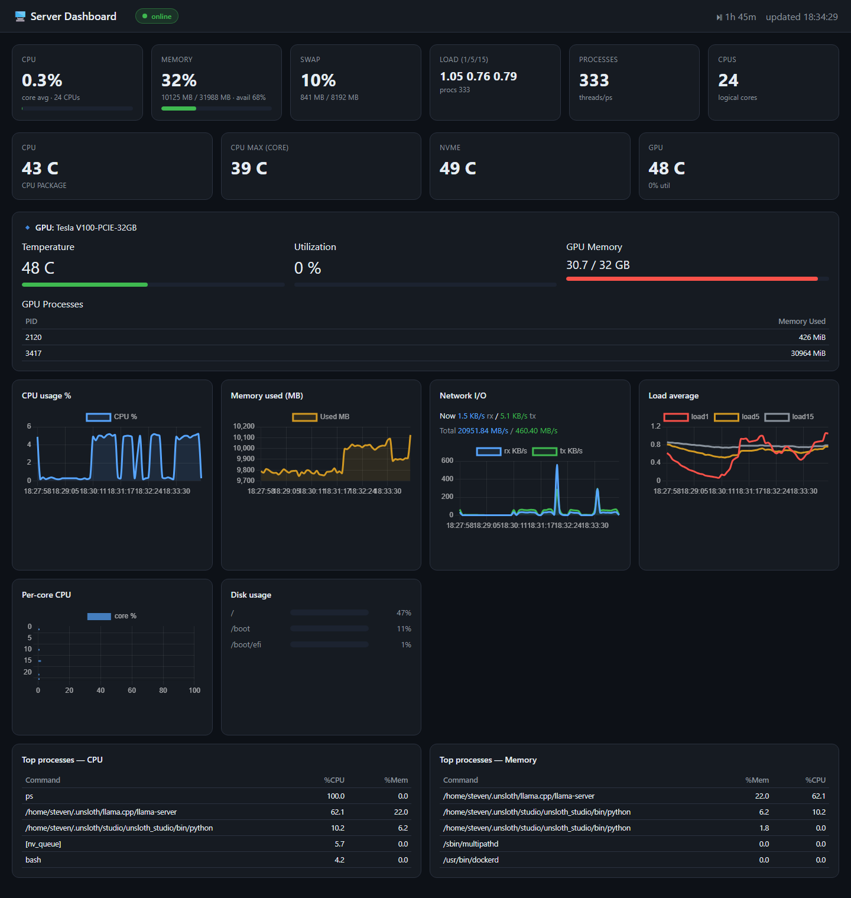

# Server Dashboard

A small custom web dashboard that monitors a **remote Linux server** over SSH and
displays real-time CPU, memory, disk, network, load, **temperature** and **GPU**
metrics plus top processes. Everything runs in Docker on this Windows machine —
**nothing is installed on the target server**.

Live layout (full-width, charts 4 across, drag any card to reorder):



## How it works

```
Windows (this box)                Remote Linux server
┌───────────────────────┐   SSH   ┌────────────────────────┐
│ docker-compose         │ ─────▶ │ /proc, free, df, ps ... │
│  └─ dashboard (FastAPI)│  reads  │  + nvidia-smi + hwmon   │
│      • Paramiko collector (every 5s)
│      • Chart.js web UI on :8878
└───────────────────────┘
```

- **Backend** — Python/FastAPI + Paramiko. SSHes in every `COLLECT_INTERVAL`
  seconds, runs a small shell script on the host, stores results in memory, and
  serves `/api/metrics` (latest) and `/api/history` (rolling chart data).
- **Frontend** — single-page HTML + Chart.js. Polls `/api/history` every 3s.
  Cards and the whole layout are **drag-and-drop reorderable** (saved to your
  browser).

## Features

- CPU (total + per-core bars), memory/swap, load average
- Disk usage bars, network I/O + throughput
- **Temperature** — CPU package, hottest core, NVMe, GPU
- **GPU status** (NVIDIA) — temperature, utilization, memory used/total, and
  the processes using the GPU
- Top-5 CPU and memory processes
- Real-time charts with a rolling history window
- Full-width, responsive layout (charts 4 across, 2 under 1400px, 1 under 800px)

## Requirements

- Docker Desktop running on this Windows machine.
- SSH access to the target server (IP/port/username/password) from this machine.
- On the target server: `nvidia-smi` on the PATH for GPU readings, and the
  thermal files under `/sys/class/thermal` / `/sys/class/hwmon` for temps.

## Configure

Edit `.env`:

```
SSH_HOST=192.168.1.154
SSH_PORT=22
SSH_USER=steven
SSH_PASSWORD=change-me      # put your real password here, in .env (gitignored)
COLLECT_INTERVAL=5        # seconds between samples
```

> `.env` is not tracked by git on purpose — it holds the SSH password.

## Run

```powershell
cd server-dashboard
docker compose up -d --build
```

Then open **http://localhost:8878** in your browser.

### Reach it from other computers on your LAN

The container publishes to all interfaces, so once Windows Firewall allows it,
any device on your network can open **http://\<this-PC-LAN-IP\>:8878** (find the
IP with `ipconfig`; here it is **192.168.1.123**).

The first time you expose it on a Private network, add one inbound firewall rule
by running PowerShell **as Administrator**:

```powershell
New-NetFirewallRule -DisplayName "Server Dashboard (8878)" -Direction Inbound -LocalPort 8878 -Protocol TCP -Action Allow -Profile Domain,Private
```

(Your network is classified **Private**, so this covers it. Skip this step only if
you already have a permissive inbound rule.)

## Useful commands

```powershell
docker compose logs -f dashboard     # watch logs / SSH errors
docker compose restart dashboard     # after editing .env
docker compose down                  # stop and remove
```

## API

| Endpoint          | Returns                                   |
|-------------------|-------------------------------------------|
| `GET /`           | The dashboard UI                          |
| `GET /api/metrics`| Latest snapshot (has `error` when failing)|
| `GET /api/history`| Rolling time-series for charts            |
| `GET /api/config` | Connection config                         |
| `GET /health`     | Health check                              |

The `/api/metrics` snapshot includes, among the standard metrics, `gpu` (array of
NVIDIA GPUs), `gpu_procs`, `gpu_temp`, `gpu_util`, `gpu_mem_used`, `gpu_mem_total`,
and `temps` (array of `{ source, label, c }` temperature readings).

## Notes / limitations

- **CPU % is instantaneous** (two 1s samples). Per-process `%CPU` comes from
  `ps` and reflects lifetime average, not instantaneous.
- Network rates are bytes/sec averaged over the sample interval.
- Disk list excludes `tmpfs`/`devtmpfs`/`squashfs` virtual mounts.
- The frontend loads Chart.js and SortableJS from a CDN, so the browser needs
  internet. To make it fully offline, download both libraries locally and point
  the `<script src>` attributes at them.
- Layout (card order) is stored per-browser in `localStorage`; each device keeps
  its own arrangement.

## Project layout

```
server-dashboard/
├── backend/
│   ├── app.py                 # FastAPI server + Paramiko SSH collector
│   ├── Dockerfile
│   ├── requirements.txt
│   └── templates/index.html   # single-page dashboard UI
├── docker-compose.yml
├── .env                       # SSH credentials (gitignored)
├── screenshots/
│   └── dashboard.png
└── README.md
```
